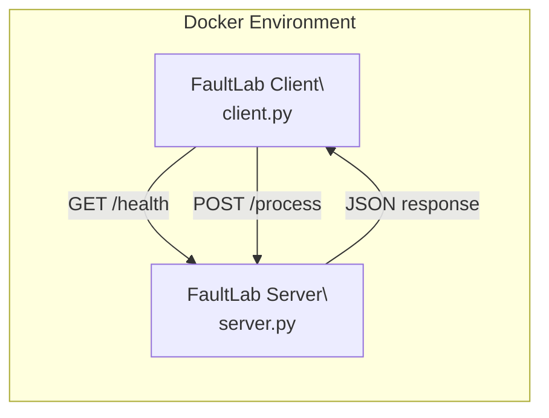
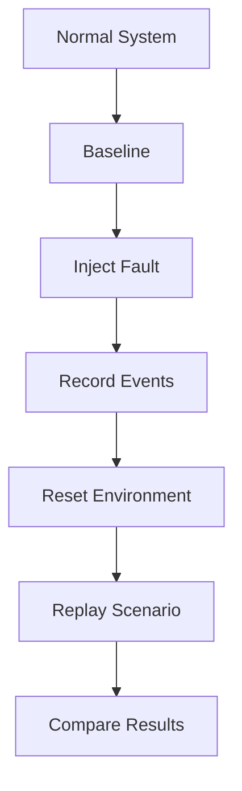
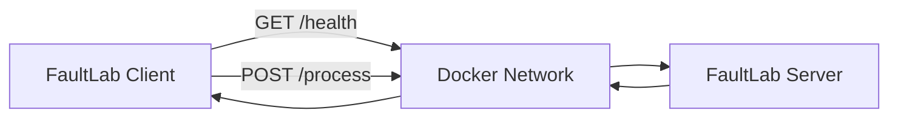

# FaultLab

FaultLab is a Docker-based Linux network fault injection, recording, and replay framework for reproducible testing of client-server applications.

The project is designed to test how a client-server application behaves under controlled failures such as network delay, packet loss, temporary disconnection, and process failure.

## Intended Workflow

**Normal System → Baseline → Inject → Record → Reset → Replay → Compare**

## Current Status

The initial client-server test environment is working.

### Implemented

- Python Flask server
- Python client
- `/health` endpoint for server health checking
- `/process` endpoint with predictable request/response behavior
- Dockerized server
- Dockerized client
- Docker Compose configuration
- Shared Docker network between client and server
- Successful client-to-server communication inside Docker
- Repeatable baseline workload with timestamped JSON results
- Container health check and verified reset workflow
- Versioned scenario schema for four approved fault categories
- Dry-run scenario validator with local-service allowlisting and bounded inputs
- Live adapters for latency, packet loss, full network disconnection, and process failure
- Timed scenario controller with guaranteed cleanup attempts
- Run IDs, planned and observed timestamps, JSONL event logs, and summary bundles
- Valid, invalid, and two-fault demonstration scenarios
- Unit tests for validation, command construction, timing, and failure cleanup

### Successful Test

- Health response: `{'status': 'healthy'}`
- Process response: `{'request_id': 'req-001', 'result': 20, 'status': 'success'}`

Recording/replay and original-versus-replay comparison remain under development. Live fault execution is implemented, but it must be verified with Docker Desktop running before a classroom demonstration.

## Validate a Scenario

The Report 1 prototype validates scenario structure and safety constraints without applying a fault.

From the repository root, run:

`python -m faultlab.scenario_validator scenarios/valid-latency.json`

The valid example should report that one action was accepted and that no fault was executed.

To inspect a clear validation failure, run:

`python -m faultlab.scenario_validator scenarios/invalid-target.json`

Run the validator and scenario-control tests with:

`python -m unittest tests.test_scenario_validator tests.test_docker_cli tests.test_fault_adapters tests.test_controller -v`

## Current Architecture



Docker Compose provides the shared network between the client and server.

Inside Docker, the client reaches the server at `http://server:5000`.

The name `server` comes from the Docker Compose service name.

## Test Workload

### GET `/health`

The `/health` endpoint verifies that the server is running and reachable.

Example response:

`{"status": "healthy"}`

### POST `/process`

The `/process` endpoint provides a small, predictable workload for FaultLab experiments.

Example request:

`{"request_id": "req-001", "value": 10}`

Example response:

`{"request_id": "req-001", "status": "success", "result": 20}`

The server currently doubles the provided value. This gives the team a predictable expected result that can later be compared before, during, and after injected faults.

## Running the Current System

### Requirements

Install:

- Git
- Docker Desktop
- Docker Compose

Python is only required if the client or server is being run directly outside Docker.

### Start the Docker Environment

From the root of the repository, run:

`docker compose up --build`

A successful run should show:

- `faultlab-client | Health: {'status': 'healthy'}`
- `faultlab-client | Process: {'request_id': 'req-001', 'result': 20, 'status': 'success'}`

The client exits after completing its requests.

The server remains available until the Docker environment is stopped.

### Stop the Environment

Press `CTRL + C`.

Then clean up the containers and network with:

`docker compose down`

## Running the Baseline

The baseline workload sends repeated `/process` requests to the server, times each one, checks that the response is actually correct (not just a 200 status), and saves simple summary statistics.

The `baseline` service does not start with a normal `docker compose up`. It only runs when you ask for it:

`docker compose run --rm baseline`

This waits for the server's Docker healthcheck to pass, runs the configured number of requests, prints a short summary, and saves a results file.

You can adjust the run with environment variables (defaults shown):

- `BASELINE_REQUESTS=20`
- `REQUEST_TIMEOUT_SECONDS=3`
- `HEALTH_TIMEOUT_SECONDS=30`
- `REQUEST_INTERVAL_SECONDS=0` (pause between requests; useful during fault demos)

Example with a smaller run:

`docker compose run --rm -e BASELINE_REQUESTS=5 baseline`

### Where Results Are Saved

Each run writes a timestamped JSON file to the `results/` folder on the host, e.g. `results/baseline_20261021T073133Z.json`. It contains the server URL, start/finish times, every individual request result, and the summary statistics (success rate, min/max/mean/median/standard deviation latency).

These generated result files are not committed to the repository; only the `results/` folder itself is tracked.

## Running the Reset Workflow

`reset.py` returns the environment to a known-good state: it stops the current Compose environment, rebuilds a clean server, waits for it to become healthy, and checks `/health` and `/process` to confirm it behaves correctly.

`python reset.py`

A successful run prints `RESET PASSED` and exits with code `0`. A failed run prints `RESET FAILED` with a reason and exits with a non-zero code.

Recreating the server removes any stale container-level network state. The reset then inspects the rebuilt interface and fails if a `netem` queue remains active.

## Running Fault Scenarios

The controller accepts JSON data only. Scenario files cannot contain shell commands, services are allowlisted, numeric values are bounded, and version 1.0 rejects overlapping actions so one cleanup cannot remove another action's fault.

First build and start the server with the Linux `tc` utility and local `NET_ADMIN` capability:

`docker compose up -d --build server`

Check the complete two-fault schedule without changing Docker:

`python -m faultlab.controller scenarios/demo-latency-packet-loss.json --dry-run`

Run the live latency and packet-loss scenario:

`python -m faultlab.controller scenarios/demo-latency-packet-loss.json`

The controller stores each run under `results/experiments/<run-id>/`:

- `scenario.json` is the exact validated scenario snapshot.
- `events.jsonl` records run IDs, UTC timestamps, planned offsets, observed offsets, applications, and cleanup events.
- `summary.json` records completion status, timing drift, and cleanup verification.

Individual live examples are also available:

- `scenarios/valid-latency.json`
- `scenarios/valid-packet-loss.json`
- `scenarios/valid-disconnect.json`
- `scenarios/valid-process-failure.json`

Always run `python reset.py` after an experiment. The controller also attempts immediate cleanup if an action or run fails.

### Report 2 Demonstration Sequence

1. Run a normal baseline: `docker compose run --rm baseline`.
2. In one terminal, start a long workload: `docker compose run --rm -e BASELINE_REQUESTS=30 -e REQUEST_INTERVAL_SECONDS=0.5 -e REQUEST_TIMEOUT_SECONDS=1 baseline`.
3. While that workload is running, use another terminal to run: `python -m faultlab.controller scenarios/demo-latency-packet-loss.json`.
4. Run `python reset.py` and show `RESET PASSED`.
5. Run another normal baseline to demonstrate recovery.

This produces baseline result files plus a separate scenario event bundle. It implements the current integration path: **Baseline -> Inject -> Record -> Reset**.

## Running the Tests

Test dependencies (`pytest`) are kept separate from the runtime `requirements.txt`, in `requirements-dev.txt`.

```
pip install -r requirements-dev.txt
pytest tests/
```

Most tests run without Docker at all, by checking the baseline logic directly (summary statistics, response validation, and failure handling). One test in `tests/test_integration.py` talks to a real server and is skipped automatically if nothing is running at `SERVER_URL`.

## Project Structure

- `client/`
  - `client.py`
  - `Dockerfile`
- `server/`
  - `server.py`
  - `Dockerfile`
- `baseline/`
  - `baseline.py`
  - `Dockerfile`
- `tests/`
  - `conftest.py`
  - `test_baseline.py`
  - `test_integration.py`
  - `test_scenario_validator.py`
  - `test_fault_adapters.py`
  - `test_docker_cli.py`
  - `test_controller.py`
- `results/`
- `reset.py`
- `compose.yaml`
- `docs/integration-contract.md`
- `docs/tc-netem-research-notes.md`
- `faultlab/`
  - `controller.py`
  - `docker_cli.py`
  - `fault_adapters.py`
  - `scenario_validator.py`
- `scenarios/`
  - `scenario.schema.json`
  - `valid-latency.json`
  - `valid-packet-loss.json`
  - `valid-disconnect.json`
  - `valid-process-failure.json`
  - `demo-latency-packet-loss.json`
  - `invalid-target.json`
- `requirements.txt`
- `requirements-dev.txt`
- `README.md`
- `.gitignore`

## Development Assistance Disclosure

The initial scenario-validation scaffold, examples, tests, and related README text were generated with OpenAI Codex on October 4, 2026. The fault adapters, controller, additional examples, and tests were AI-assisted with OpenAI Codex on October 22, 2026. Under the course policy, this material must be treated as AI-assisted work rather than an original student artifact. A student must personally review, modify, test, understand, and accurately document any portion retained in the project.

## Team Responsibilities

### Dubem Akukwe

**Network Environment and Integration Lead**

Primary responsibilities:

- Docker client/server test environment
- Repeatable baseline workload
- Reset workflow
- Health checks
- System integration
- End-to-end testing
- Release setup
- Integration of the fault-injection and recording/replay components

Current progress:

- Basic Python client/server workload completed
- Server health check completed
- Predictable `/process` workload completed
- Client Docker image completed
- Server Docker image completed
- Docker Compose environment completed
- Docker client-to-server communication verified
- Baseline measurements and timestamped result files completed
- Reset and post-reset health verification completed

### Fidel Anyanwu

**Fault Injection and Scenario-Control Lead**

Primary responsibilities:

- Linux traffic control
- `tc/netem`
- Latency injection
- Packet-loss injection
- Connection disruption
- Process faults
- Timed fault execution
- Scenario control
- Fault cleanup and recovery

The fault-control component now builds on the shared Docker client/server environment.

Current progress:

- Bounded scenario schema and validator completed
- Latency and packet-loss `tc/netem` adapters completed
- Full Docker network disconnection/reconnection control completed
- SIGTERM/SIGKILL process-failure control completed
- Timed, non-overlapping scenario controller completed
- Per-run scenario snapshots, event logs, and timing summaries completed
- Cleanup verification and reset integration completed
- Unit-test coverage for successful and interrupted runs completed
- Live Docker verification still required before the Report 2 demonstration

Suggested branch: `fidel/fault-injection`

### Chidera Chuka

**Recording, Replay, and Evaluation Lead**

Primary responsibilities:

- Experiment event recording
- Run IDs
- Timestamps
- Recording scheduled and observed fault events
- Replaying saved scenarios
- Comparing original and replay runs
- Reproducibility evaluation
- Recording differences between expected and observed behavior

The shared scenario and event formats will be defined as the fault-injection and recording components begin integration.

Suggested branch: `chidera/record-replay`

## Git Workflow

Development should not be performed directly on `main`.

Each team member should work on a separate branch.

Suggested branches:

- `dubem/test-environment`
- `fidel/fault-injection`
- `chidera/record-replay`

Workflow:

1. Create or switch to your branch.
2. Make changes.
3. Test the changes.
4. Commit the changes.
5. Push the branch.
6. Open a pull request.
7. Review the pull request.
8. Merge into `main`.

The `main` branch should represent the most stable integrated version of FaultLab.

## Planned FaultLab Workflow



### Normal System

Start the Docker client/server environment and confirm that the application works correctly without faults.

### Baseline

Run the workload under normal conditions and record expected behavior such as:

- Successful requests
- Response values
- Response times
- Errors
- Recovery state

### Inject

Apply controlled faults such as:

- Latency
- Packet loss
- Temporary connection disruption
- Process interruption

### Record

Record the fault scenario and experiment events, including timing and observed behavior.

### Reset

Return the test environment to a known healthy state before another experiment.

### Replay

Reapply a previously recorded scenario using the same event order and timing information.

### Compare

Compare the original experiment with the replay to evaluate how consistently the same failure behavior can be reproduced.

## Planned Development Milestones

1. Baseline measurement and logging
2. Initial latency fault injection
3. Packet-loss fault injection
4. Process or connection disruption
5. Shared scenario format
6. Experiment event recording
7. Reset and cleanup workflow
8. Scenario replay
9. Original-versus-replay comparison
10. Integration testing
11. Documentation and release setup

The first priority is to complete a working minimum viable FaultLab system before adding optional features.

## Minimum Viable FaultLab

The minimum working version of FaultLab should support:

- Docker-based client/server environment
- Predictable baseline workload
- Latency fault
- Packet-loss fault
- One process or connection disruption
- Fault recording
- Environment reset
- Scenario replay
- Comparison between original and replay behavior

Additional features should only be added after the minimum system works reliably.

## Current Development Checkpoint

The current working system is:



The client and server are both running in Docker containers and successfully communicating through the Docker network.

This provides the shared test environment required for the next phase of FaultLab development.
