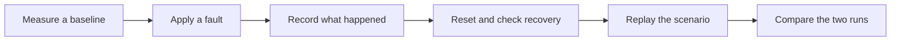
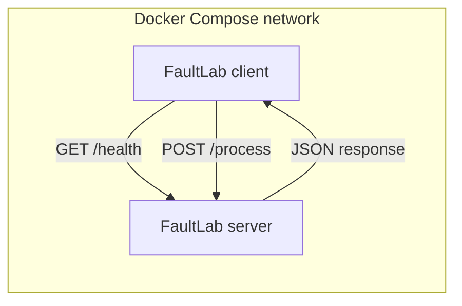

# FaultLab

If a server takes half a second to answer, how can we tell whether the delay came from our experiment? And if we stop the experiment halfway through, how do we know the server is back to normal? FaultLab gives us a small Docker setup where we can ask both questions with the same request. The client sends the number 10, the server doubles it, and we check how long it takes to get 20 back.

Our full project follows this sequence:



The experiment dashboard runs the local workload, shows when each fault takes effect, and checks that the server recovers. It can rerun a saved scenario and compare requests. Chidera's separate recorder and event-replay work uses the shared controller log.

## Run the client and server

Start Docker Desktop and wait for the engine to run. Open PowerShell in the FaultLab folder (the one containing `compose.yaml`) and run:

```powershell
docker compose up --build
```

Look for these two lines in the client output. The first means the server answered the health check. The second means the client sent 10 and got the expected answer back.

```text
Health: PASS - server is healthy
Process: PASS - process request succeeded, result=20
```

The two calls use the same small Flask server. You can follow the request through the [client](client/client.py) and the [server](server/server.py):



The client exits after those checks. The server keeps running. Inside Docker, its address is `http://server:5000`. From your computer, use `http://127.0.0.1:5000`. When you're finished with this first run, press Ctrl+C and run `docker compose down`.

## Try a fault and watch the server recover

For the controller, reset script, and tests, you'll also need Python. We use Python 3.12 in CI. The first time you work in this checkout, create an environment from the repository root:

```powershell
python -m venv .venv
.\.venv\Scripts\Activate.ps1
python -m pip install -r requirements-dev.txt
```

When you come back to the project, activate the existing environment. Start the server in the background and take a baseline:

```powershell
docker compose up -d --build --wait server
docker compose run --rm --build baseline
```

By default the baseline sends 20 requests. Open the timestamped JSON file in `results/` and check `summary.successful_requests` and `summary.latency_ms.mean`. The baseline can finish even when individual requests fail.

### Run a measured experiment

With the server running and the Python environment active, open the dashboard from the FaultLab folder.

```powershell
python -m faultlab.dashboard
```

Choose **Delay, then packet loss** and click **Start experiment**. The dots show successful requests, crosses show failed requests, and shading shows when the controller confirmed each fault was active. Choose a single fault to change its duration or its delay or loss setting. Choose 5 or 10 trials to see how much the results vary.

**Open results** opens a self-contained HTML report you can share. Expand a trial to see which requests landed inside each fault. **Replay saved run** accepts an `experiment.json` from an earlier trial and compares the new outcomes with that original. **Stop after cleanup** ends an experiment early and lets the controller restore the server. **Reset stack** rebuilds the local server and verifies recovery.

The same experiment runs from PowerShell:

```powershell
python -m faultlab.experiment --scenario scenarios/demo-latency-packet-loss.json --trials 5
python -m faultlab.experiment --replay docs/evidence/experiment-2026-11-22/experiment.json --trials 1
```

Results go in `results/series/`. For a completed example, see the [ten-trial results](docs/evidence/experiment-2026-11-22/report.html) and the [recorded metrics](docs/evidence/experiment-2026-11-22/series.json).

### Run the workload and controller separately

For the two-fault demo, first preview the schedule. A dry run writes example events without changing Docker:

```powershell
python -m faultlab.controller scenarios/demo-latency-packet-loss.json --dry-run
```

1. In a second terminal, open the same FaultLab folder. Start a workload that spaces out its requests so you have time to apply a fault:
   ```powershell
   docker compose run --rm -e BASELINE_REQUESTS=30 -e REQUEST_INTERVAL_SECONDS=0.5 -e REQUEST_TIMEOUT_SECONDS=1 baseline
   ```
2. Once the workload starts sending requests, run the live scenario in the first terminal:
   ```powershell
   python -m faultlab.controller scenarios/demo-latency-packet-loss.json
   ```
   It delays outgoing packets first, removes the delay, then drops a portion of outgoing packets. Retries can make a request slow even when it eventually succeeds.
3. Let both commands finish. Open `events.jsonl` in the run folder printed by the controller. Find `fault_applied` and `fault_cleaned` for each action. The baseline file shows what the client experienced during that workload.
4. Rebuild the server, verify it, and send a fresh baseline:
   ```powershell
   python reset.py
   docker compose run --rm baseline
   ```
   Look for `RESET PASSED`, then check the new baseline's success count. Run one controller at a time and let it finish cleanup before resetting the stack.

## Where to look next

| If you want to… | Start here |
| --- | --- |
| Try a delay, packet loss, a disconnect, or a stopped process on its own | [Fault-control guide](docs/fault-control-guide.md) and [sample scenarios](scenarios/) |
| Check request formats, baseline settings, exit codes, or reset behavior | [Client, server, baseline, and reset reference](docs/INTEGRATION.md) |
| Read or integrate a controller run | [Scenario and event format](docs/integration-contract.md) |
| Understand why the network settings and HTTP measurements differ | [Network emulation research notes](docs/tc-netem-research-notes.md) |
| See the November 20 results, including an interrupted run | [Fidel's progress note](docs/fidel-progress-2026-11-20.md) and [trial results](docs/evidence/fault-safety-2026-11-20/summary.csv) |

## Run the checks

With the Python environment active and the server running, run `python -m pytest tests/`. Most tests run locally. The live integration test needs a reachable server. For the repeatable before, during, and after measurements, run:

```powershell
docker compose build baseline
python -m faultlab.safety_check --trials 2
```

This runs each fault twice and checks an interrupted delay separately. The runner prints the path to its results under `results/fault-safety/`. GitHub Actions runs the unit tests and a Docker check on pull requests. When you finish working locally, use `docker compose down` to stop the stack.

## Who works on what

| Team member | Responsibility |
| --- | --- |
| Dubem Akukwe | Builds the Docker environment, client, baseline, and reset checks. Brings the components together for end-to-end testing and release. |
| Fidel Anyanwu | Owns scenario validation, timed fault injection, and immediate cleanup. Checks what happens to requests while a fault is active and after it ends. |
| Chidera Chuka | Owns observation recording, experiment bundles, replay, and the comparison between an original run and its replay. |

We work on individual branches, test our changes, and open a pull request for a teammate to review before merging into `main`.

## Development assistance disclosure

On October 4, 2026, Codex generated the initial scenario-validator. On October 22, it helped develop the fault adapters, controller, and tests. On November 20 it helped develop and test the reliability changes.

On November 22, Codex helped implement and test the scheduling changes, measured experiment runner, dashboard, and results report.
